# Kaiju · Inventario y trazabilidad

App Android para el caso **Kaiju** (DSY1105 · Desarrollo de Aplicaciones Móviles · Duoc UC 2026-2).

## Descripción

Kaiju controla hoy su inventario con registros manuales y planillas, lo que genera diferencias de stock, movimientos sin registrar y reposiciones tardías. Esta app lo resuelve en tres frentes:

- **Stock al día:** cada entrada, venta, consumo o ajuste actualiza la cantidad disponible al instante.
- **Trazabilidad:** cada movimiento queda registrado con fecha, tipo, cantidad, usuario y motivo, y no se edita ni se borra.
- **Alertas de reposición:** un producto entra en alerta cuando su disponible llega a su stock mínimo; la app lo marca, lo lista en Alertas y avisa al teléfono.

Cada perfil ve solo lo que le corresponde (administrador, personal de venta y encargado de inventario). Está construida con Kotlin, Jetpack Compose y Material 3, arquitectura MVVM y persistencia local con Room. Todos los datos son ficticios.

## Integrantes participantes

| Nombre completo | Correo |
| --- | --- |
| Vicente Hueichapan Poblete | vi.hueichapan@duocuc.cl |
| Diego Burgos Lopez | di.burgosl@duocuc.cl |

Aporte de cada integrante:

- **Vicente Hueichapan**: análisis del caso y desarrollo de la app (pantallas, ViewModel, validaciones, Room y recursos nativos).
- **Diego Burgos** ([@DiegoBurgosL](https://github.com/DiegoBurgosL)): auditoría final y ajustes (control de stock en las entradas, diseño negro con bordes blancos, colores por sección y capturas de evidencia).

## Funcionalidades implementadas

| Requerimiento | Funcionalidad | Pantalla |
|---|---|---|
| RF-01 | Ingresar con un usuario de prueba; la app muestra solo lo que corresponde a su perfil | Login |
| RF-02 | Catálogo con nombre, categoría, precio y cantidad disponible | Catálogo |
| RF-03 | Búsqueda por nombre o código y filtro por categoría | Catálogo |
| RF-04 | Detalle del producto con su historial, del más reciente al más antiguo | Detalle |
| RF-05 | Crear y editar productos con formulario validado (solo administrador) | Formulario |
| RF-06 | Registrar entradas | Movimiento |
| RF-07 | Registrar salidas por venta o por consumo | Movimiento |
| RF-08 | Registrar ajustes por conteo físico, con motivo y confirmación | Movimiento |
| RF-09 | Marca de stock bajo, pantalla de alertas y notificación al teléfono | Catálogo, Movimiento, Alertas |
| RF-10 | Los datos se conservan al cerrar y volver a abrir la app (Room) | Toda la app |
| RF-11 | Consultar los feriados de Chile por año, ver el próximo y cuántos productos en alerta hay antes de esa fecha (API REST, Guía 12) | Feriados |

**Reglas de negocio:** se validan en `InventarioViewModel` antes de guardar: una salida nunca deja el stock bajo cero (RN-01); el precio es mayor que cero y el mínimo mayor o igual a cero (RN-02); el código es obligatorio y único (RN-03); todo ajuste exige motivo (RN-04); y un producto está en alerta cuando su disponible es igual o menor a su mínimo (RN-06). RN-05 se cumple en la base de datos: cada movimiento guarda fecha, tipo, cantidad y usuario, no existen operaciones para editarlo ni borrarlo, y el stock y su movimiento se guardan juntos en una sola transacción.

**Permisos por perfil:**

| Perfil | Puede |
|---|---|
| Administrador | Crear y editar productos, registrar entradas y ajustes, ver alertas |
| Personal de venta | Consultar y registrar salidas por venta |
| Encargado de inventario | Registrar entradas, salidas por venta o consumo y ajustes, ver alertas |

**Stock inicial y ajuste:** un producto nuevo se crea con 0 unidades y su stock entra con una Entrada (la app la ofrece al guardarlo), para que toda unidad tenga historial. El ajuste funciona como un conteo físico: se ingresa lo contado, la app muestra la diferencia, pide confirmar y guarda esa diferencia con su motivo.

## Pasos para ejecutar

**Requisitos:** Android Studio 2026.1 o superior (incluye el JDK) e internet la primera vez, para que Gradle descargue las dependencias.

1. Clonar el repositorio:
   ```bash
   git clone https://github.com/vicenteehueichapan-boop/AplicacionKaiju.git
   ```
2. En Android Studio: **File → Open** y elegir la carpeta **`android/`**.
3. Esperar a que termine la sincronización de Gradle.
4. Crear o elegir un emulador en **Device Manager** (Android 8.0 o superior; se probó en Android 16, API 36).
5. Presionar **Run ▶** sobre el módulo `app`.
6. Ingresar con uno de los usuarios de prueba: **Administrador de prueba**, **Vendedor de prueba** o **Inventario de prueba**.

Pruebas unitarias, desde la carpeta `android/` (en Windows, `gradlew.bat` en vez de `./gradlew`):

```bash
./gradlew testDebugUnitTest
```

## Decisiones del proyecto

### Recursos nativos · ficha de decisión

Los dos recursos salen del caso: "notificaciones asociadas a niveles mínimos de stock" y "uso de la cámara para lectura de códigos QR o códigos de barras".

| Necesidad del caso | Recurso y API | Permiso y tipo | RF | Si el usuario dice que no |
|---|---|---|---|---|
| El encargado de inventario y el administrador necesitan enterarse cuando un producto llega a su mínimo | Notificaciones · `NotificationCompat` con canal propio | `POST_NOTIFICATIONS`, de tiempo de ejecución (Android 13+) | RF-09 | La pantalla Alertas sigue mostrando los productos y ofrece activarlo en Ajustes |
| Quien registra un movimiento necesita elegir el producto rápido y sin equivocarse de código | Cámara · Google code scanner (ML Kit) | Ninguno: Google Play services abre el lector y devuelve solo el código | RF-06, RF-07 | Elegir el producto de la lista |

- **Permiso en contexto:** se pide al tocar "Activar avisos" en Alertas, nunca al abrir la app. Si el usuario ya lo rechazó, la app explica antes de volver a pedirlo, con opción de decir "Ahora no". Al volver a la app se verifica otra vez (`LifecycleResumeEffect`).
- **Manifiesto:** declara `POST_NOTIFICATIONS` y la cámara como opcional (`uses-feature camera.any`, `required="false"`); antes de abrir el lector se revisa que el equipo tenga cámara.
- **MVVM:** el permiso se pide en la pantalla; el código leído y la decisión de avisar quedan en el ViewModel. La notificación se envía una vez, cuando un movimiento hace entrar un producto en alerta.
- **Emulador:** el lector necesita Google Play services con Play Store; si no está disponible, la app lo informa y ofrece elegir el producto de la lista.

### Animaciones

- **Marca "Stock bajo":** aparece y desaparece con `AnimatedVisibility` cuando un movimiento cruza el mínimo; se ve en la misma pantalla de Movimiento al registrar.
- **Color del disponible:** cambia de forma gradual con `animateColorAsState` al entrar o salir de alerta.
- **Navegación:** la pantalla nueva entra deslizándose; avanzar entra por la derecha y volver, por la izquierda.
- **Confirmación:** un Snackbar indica lo que se guardó y el disponible resultante.

### Identidad visual

Tema oscuro de Material 3 en negro, con acentos blancos y tarjetas con borde blanco suave, definido en `ui/theme/Theme.kt`. Cada sección del menú inferior tiene su color (Catálogo azul, Movimiento cian y Alertas rojo) para reconocerla de un vistazo. El rojo se reserva para stock bajo y errores; el verde, para el disponible normal y las entradas; el naranja, para las salidas. Cada pantalla tiene título, bajada e indicadores grandes, y la app tiene un ícono propio.

### Módulo propio

No incluido. Las opciones que plantea el caso (productos más y menos vendidos, tendencias de venta) requieren que el cliente defina cómo se miden y en qué período; se implementarán después de la entrevista. La base de la Guía 10 está completa.

## Integración con API REST: calendario de reposición (Guía 12, Opción B)

Funcionalidad complementaria que consume una API externa con **Retrofit** y corrutinas, organizada en MVVM. Responde al problema de las reposiciones tardías: antes de un feriado, proveedores y despachos se detienen, por lo que conviene reponer con anticipación los productos que ya están en alerta de stock.

### API elegida

**Nager.Date** (<https://date.nager.at/Api>): API pública y gratuita de feriados, sin API Key ni registro. Es de solo lectura (GET) y responde en JSON.

| Concepto | Valor |
|---|---|
| URL base | `https://date.nager.at/api/v3/` |
| Endpoint | `GET PublicHolidays/{anio}/{pais}`; la app usa `pais = CL`, por ejemplo `https://date.nager.at/api/v3/PublicHolidays/2026/CL` |
| Convertidor | Gson, hacia la data class `FeriadoDto` |
| Código de estado | `200` éxito; `400` o `404` el año no está disponible |

Extracto de la respuesta (cada feriado es un objeto de la lista):

```json
[{ "date": "2026-12-08", "localName": "Inmaculada Concepción", "name": "Immaculate Conception",
   "countryCode": "CL", "global": true, "types": ["Public"] }]
```

### Qué muestra la pantalla

- Un campo **Año** (por defecto el año actual) y el botón **Buscar**.
- Tarjeta con el **próximo feriado**, su fecha y los días que faltan (solo cuando se consulta el año en curso).
- Tarjeta de **stock**: cuántos productos están hoy en alerta y un aviso para reponerlos antes de esa fecha. Usa los datos de Alertas que la app ya tiene.
- Lista de todos los feriados del año, con el próximo destacado.
- Tres estados claros: **carga** (`CircularProgressIndicator`), **éxito** (datos en pantalla) y **error** (mensaje claro y botón **Reintentar**).

### Cómo acceder a la función

1. Ejecutar la app (necesita internet) e ingresar como **Administrador de prueba** o **Inventario de prueba**.
2. Tocar la pestaña **Feriados** del menú inferior (a la derecha de Alertas).

El perfil **Vendedor** no ve la pestaña, igual que Alertas: la reposición no es parte de sus tareas.

### Cómo probar los casos

| Caso | Pasos | Resultado esperado |
|---|---|---|
| Consulta exitosa | Abrir Feriados (carga el año actual) o escribir `2027` y tocar **Buscar** | Se ve el indicador de carga y luego el resumen y la lista de feriados. |
| Mismo año otra vez | Buscar de nuevo un año ya consultado | Aparece "Datos reutilizados de una consulta anterior": no hay nueva llamada a la API. |
| Entrada inválida | Dejar el campo vacío, o escribir `abcd`, `26` o `1800`, y tocar **Buscar** | Mensaje de error bajo el campo; no se hace ninguna petición y se mantiene lo que había en pantalla. |
| Fallo de conexión | Activar el modo avión y buscar un año que no se haya consultado | Mensaje "No hay conexión a internet" con botón **Reintentar**. |
| Recuperación | Desactivar el modo avión y tocar **Reintentar** | Se carga la lista y desaparece el error. |
| Rotación | Girar el teléfono | El ViewModel conserva el estado, sin nueva consulta. |

Pruebas unitarias (sin red, con una API falsa), desde la carpeta `android/`:

```bash
./gradlew testDebugUnitTest
```

`FeriadosViewModelTest` cubre: consulta exitosa con el cálculo del próximo feriado, uso de la caché, entradas inválidas sin llamada a la API, fallo de conexión con recuperación al reintentar, tiempo agotado y respuesta sin feriados.

### Recorrido de los datos por capa MVVM

```text
Usuario toca "Buscar"
  → Pantalla       PantallaFeriados envía la acción al ViewModel
  → ViewModel      FeriadosViewModel.consultar() valida el año (4 dígitos, entre 2000 y 2100)
  → Repository     FeriadosRepository.obtenerFeriados(anio): ¿está en la caché de memoria?
  → ApiService     FeriadosApiService (Retrofit): GET PublicHolidays/{anio}/CL
  → Modelo / DTO   Gson crea List<FeriadoDto>; aModelo() la convierte en List<Feriado>
  → Repository     devuelve ResultadoFeriados (Exito o Fallo) y guarda el año en la caché
  → ViewModel      arma ContenidoFeriados (Cargando, Exito o Error) y lo publica en el StateFlow
  → Pantalla       collectAsStateWithLifecycle() y la dibuja: carga, datos o error con Reintentar
```

| Capa | Archivo (`feriados/`) | Responsabilidad |
|---|---|---|
| Modelo / DTO | `model/FeriadoDto.kt`, `model/Feriado.kt` | El DTO copia el JSON; `Feriado` es el dato ya validado (con `LocalDate`). También define `ResultadoFeriados` y `TipoFallo`. |
| ApiService | `data/FeriadosApiService.kt` | Contrato HTTP de Retrofit (`suspend`) y creación única del cliente. |
| Repository | `data/FeriadosRepository.kt` | Único que conoce la API: llama, convierte, traduce excepciones a mensajes y mantiene la caché por año. No lanza excepciones hacia el ViewModel. |
| ViewModel | `viewmodel/FeriadosViewModel.kt` | Valida la entrada, controla la consulta en curso y expone un `StateFlow` de solo lectura. Calcula el próximo feriado. |
| Pantalla | `ui/PantallaFeriados.kt` | Compose y Material 3. No tiene lógica: solo dibuja el estado y envía eventos. |

**Sin llamadas repetidas:** la primera consulta se hace en el `init` del ViewModel, una sola vez, y no dentro de un composable, así que recomponer o rotar no vuelve a llamar a la API. Además, un único Repository (`FeriadosModulo`) mantiene la caché aunque cambies de pestaña, y el botón **Buscar** se desactiva mientras carga.

**Errores contemplados:** sin conexión, tiempo agotado, año sin datos (`400`/`404`), error del servidor y respuesta que no se puede interpretar.

### Archivos existentes que se tocaron

Todo el código está en archivos nuevos (`feriados/` y su prueba). En los archivos existentes solo se agregaron líneas, sin modificar ni borrar ninguna:

| Archivo | Líneas agregadas |
|---|---|
| `app/build.gradle.kts` | Dependencias `retrofit` y `converter-gson` (2.11.0). |
| `AndroidManifest.xml` | Permiso `INTERNET`. |
| `navigation/Rutas.kt` | La ruta `Feriados`. |
| `navigation/AppNavHost.kt` | 2 imports, el destino `composable(Rutas.Feriados.ruta)` y la pestaña "Feriados" del menú inferior. |

### Captura del resultado

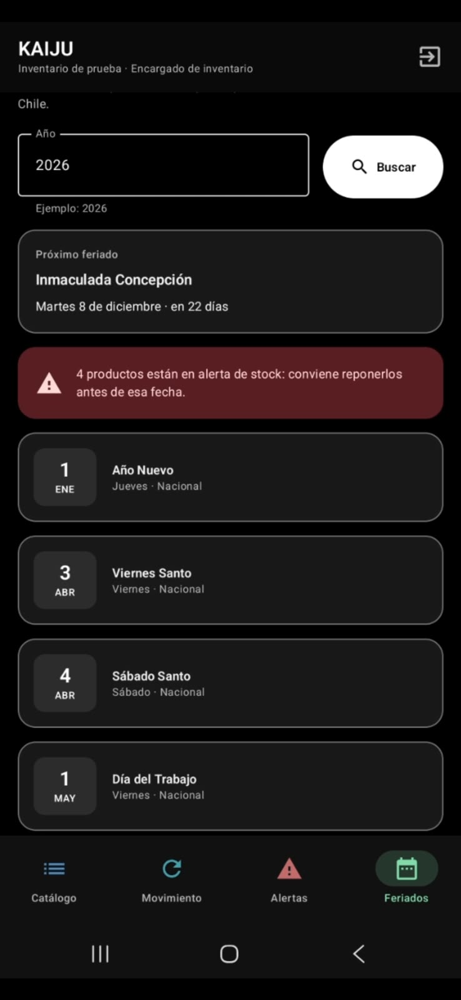

## App firmada y lista para publicar (Guía 13)

La app se compila en modo **release** y se firma con una llave propia, como pide el indicador IL3.3: un **APK firmado** para instalar y entregar, y un **AAB firmado** (Android App Bundle), que es el formato que exige Google Play para apps nuevas. No se publicó en Google Play; no es requisito del curso.

| Archivo | Para qué | Dónde queda al compilar |
|---|---|---|
| `app-release.apk` | Instalar en un teléfono o emulador y entregar el Encargo | `android/app/build/outputs/apk/release/` |
| `app-release.aab` | Subir a Google Play Console | `android/app/build/outputs/bundle/release/` |
| `practica-curso.jks` | Llave de práctica del curso (alias `practica`, válida hasta 2054) | `android/llaves/` (incluida en el repositorio) |

**Cómo está configurada la firma** (`android/app/build.gradle.kts`): Gradle lee las credenciales desde `android/keystore.properties` y las usa en `signingConfigs.release`. Ese archivo tiene las contraseñas y **no se sube a GitHub** (está en `.gitignore`). La única excepción del `.gitignore` es la llave de práctica, porque el Encargo pide entregarla; nunca se debe usar para una app real.

**Cómo generar los paquetes firmados:**

1. Copiar `android/keystore.properties.example` como `android/keystore.properties` y completar las contraseñas (las tiene el equipo).
2. En Android Studio, panel **Gradle** → `app` → `Tasks` → `build` → doble clic en **assembleRelease** (APK) y luego en **bundleRelease** (AAB). Desde la terminal, en `android/`: `./gradlew assembleRelease bundleRelease` (en Windows, `gradlew.bat`).

Sin `keystore.properties`, el proyecto igual compila, pero el APK sale como `app-release-unsigned.apk`: ese nombre indica que falta la configuración de firma.

**Cómo se comprobó la firma:**

- El archivo generado se llama `app-release.apk` (no `unsigned`).
- `app` → `Tasks` → `android` → **signingReport**: la variante `release` usa `practica-curso.jks` con el alias `practica`.
- `apksigner verify --print-certs app-release.apk` responde **Verifies** (esquema v2) con el certificado `CN=Vicente Hueichapan y Diego Burgos, OU=DSY1105 Equipo 5, O=Duoc UC`.
- El `targetSdk` es 36 (Android 16), el mínimo que exige Google Play desde el 31 de agosto de 2026.

## Capturas

Tomadas en el emulador (Android, API 37) con el diseño negro con bordes blancos. Están en [`docs/capturas`](docs/capturas).

| Ingreso por perfil | Catálogo | Búsqueda |
|---|---|---|
| 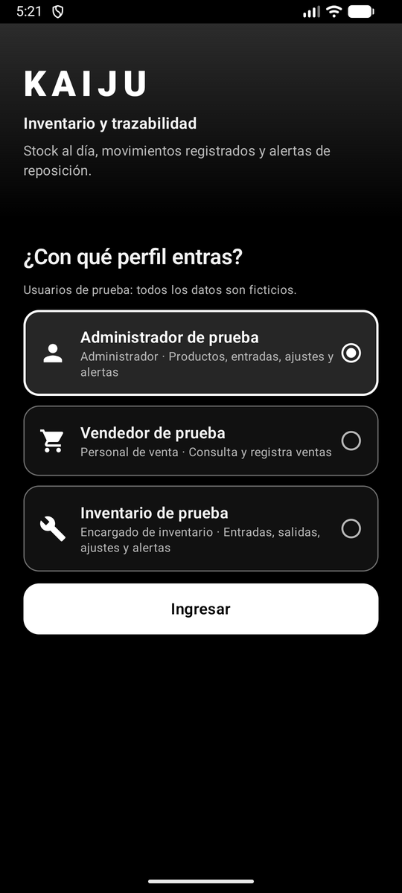 | 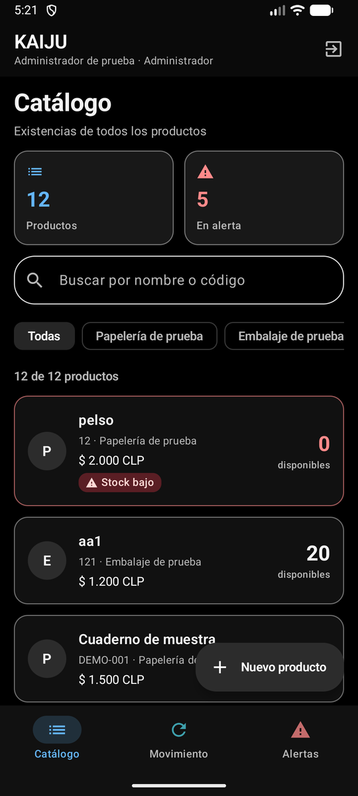 | 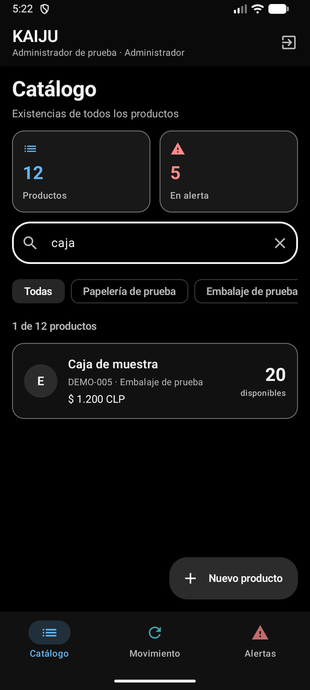 |
| **Detalle e historial** | **Nuevo producto** | **Validación por campo** |
| 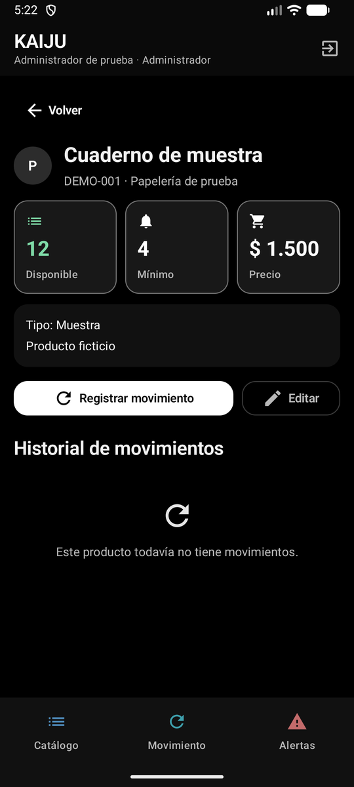 | 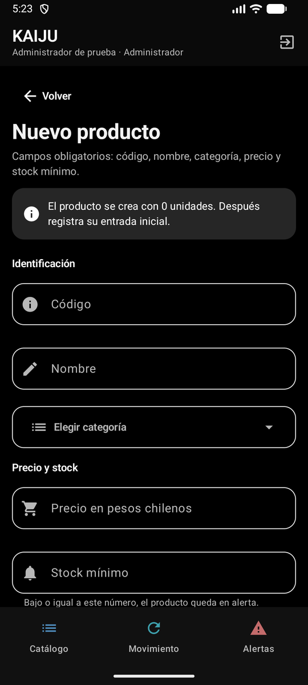 | 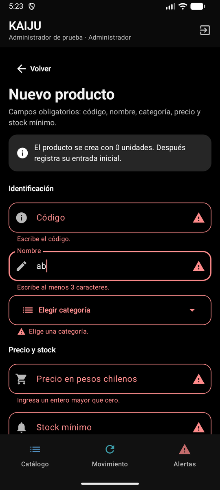 |
| **Validación (resto del formulario)** | **Registrar movimiento** | **Confirmación del ajuste** |
| 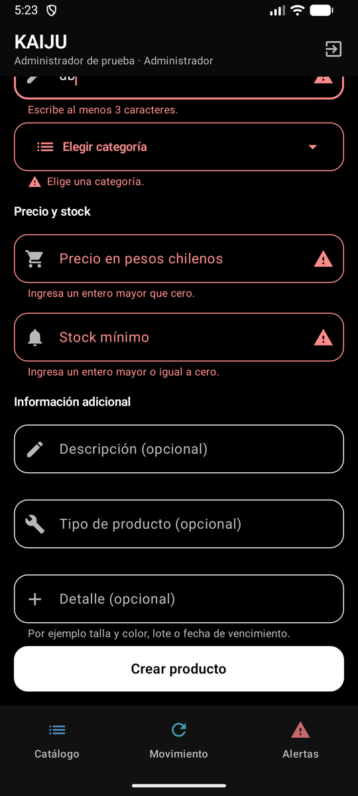 | 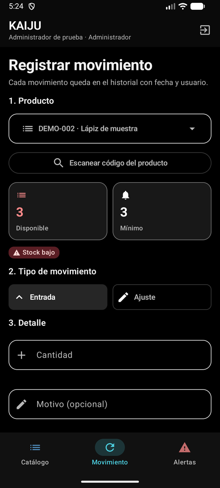 | 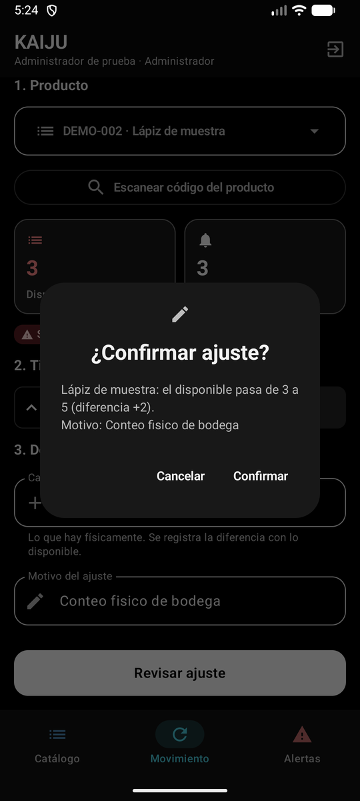 |
| **Alertas y permiso de avisos** | **Productos en alerta** | **Vista del vendedor (sin Alertas)** |
| 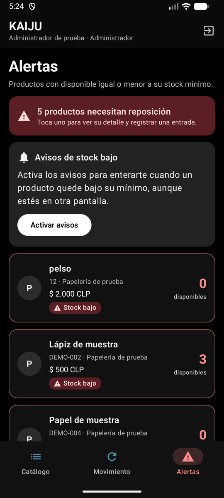 | 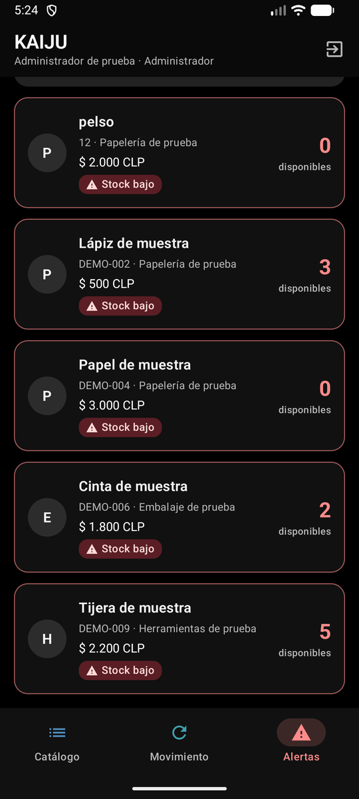 | 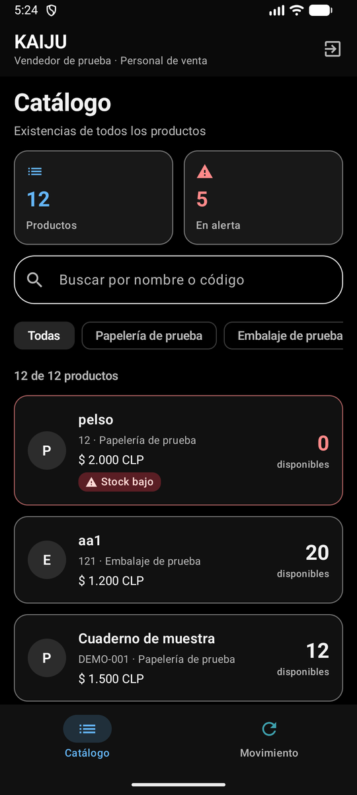 |

## Video de respaldo

[`docs/video/recorrido-app.mp4`](docs/video/recorrido-app.mp4) (5 min): recorrido de la app en el emulador, por si el equipo de la defensa no puede ejecutarla. Muestra el ingreso por perfil, el formulario con validación por campo, el alta de un producto con su entrada inicial, el permiso de notificaciones, una salida rechazada por superar el stock, la marca "Stock bajo", la notificación, la validación del ajuste, el lector de códigos, la persistencia al cerrar y abrir la app, y la vista del vendedor.

## Video del Hito 2 (Guía 13, sección 12)

[`docs/video/hito2-equipo5.mp4`](docs/video/hito2-equipo5.mp4): video de 1:26 (MP4, 720 px, 27,8 MB) con la propuesta de solución, los avances y la app funcionando. Se entregó el 17-11-2026 a las 13:01 con AzCopy en la ruta institucional `san-bernardo/desarrollo-aplicaciones-moviles/002D`, como `Videoequipo5.mp4`. Esta copia queda como respaldo; el registro de la subida está en [`docs/video/comprobante-hito2.txt`](docs/video/comprobante-hito2.txt) (AzCopy: `UPLOADSUCCESSFUL`, `Final Job Status: Completed`).

## Estructura

```text
android/app/src/main/java/cl/academico/kaiju/
├── model/         datos: Producto, Movimiento, Usuario y estado de los formularios
├── database/      Room: BaseDeDatosKaiju (singleton) e InventarioDao
├── repository/    InventarioRepository (único que conoce al DAO) y datos de prueba
├── viewmodel/     SesionViewModel, InventarioViewModel (validaciones y reglas) y su Factory
├── navigation/    rutas, NavHost y menú inferior
├── feriados/      Guía 12: API Nager.Date con Retrofit (model, data, viewmodel y ui)
└── ui/            pantallas, componentes, recursos nativos y tema
```

## Organización del equipo

- **Planificación:** tablero de Trello [Kaiju · DSY1105 · Vicente Hueichapan y Diego Burgos](https://trello.com/b/c2KIi6VL/kaiju-dsy1105-vicente-hueichapan), con las tareas por estado y fecha.
- **Código:** este repositorio, con commits de cada integrante que describen el cambio realizado. El aporte de cada uno está en [Integrantes participantes](#integrantes-participantes).
